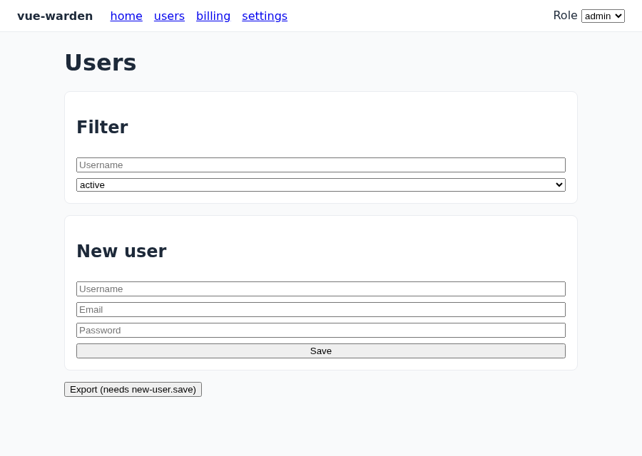
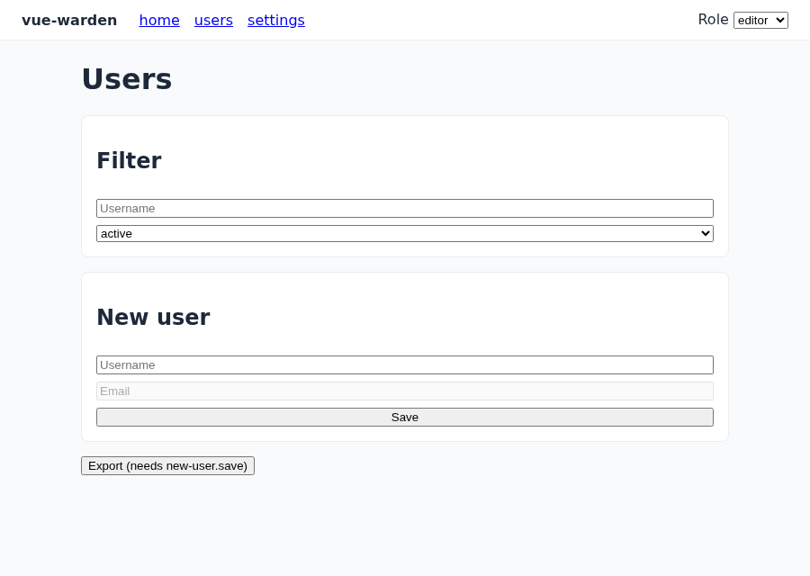
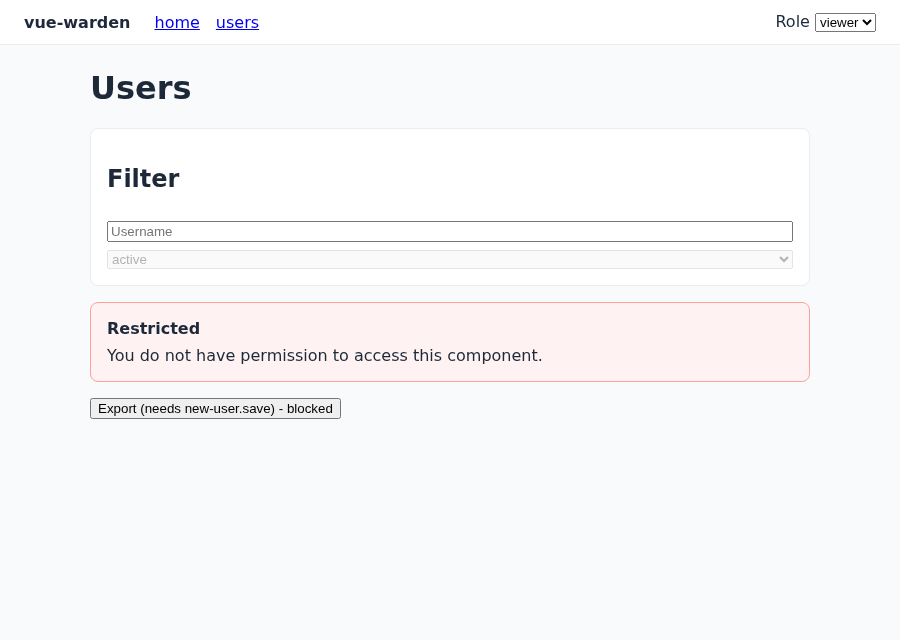
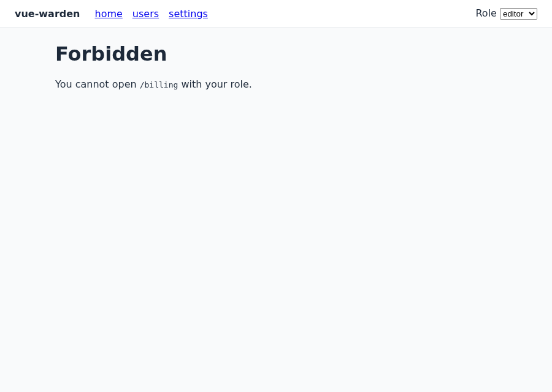
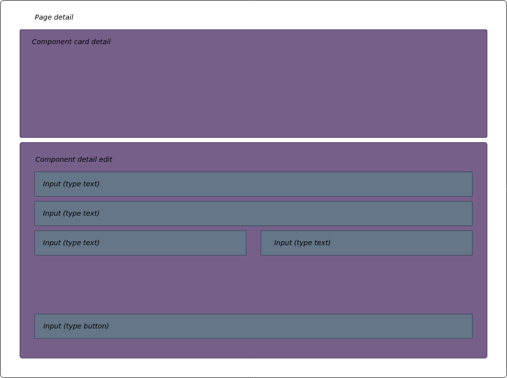

# vue-warden

Declarative, backend-driven access control for Vue 3. Hide, disable or block
pages, sections and inputs without writing a single `v-if` for permissions.

The backend decides. Each route key is sent to your API, and the response says
which components and inputs the current user may see or edit. `vue-warden`
applies that answer to the UI, caches it, and never breaks your app when the
backend fails.



## Features

- Pages, components and inputs restricted from one backend response
- Three ways to apply it: `<Warden>` / `<WardenField>`, the `v-warden` directive, and `useWarden()` for plain code
- Fully customizable "access denied" UI: global component, per-section slot, or code only
- Near-zero overhead: O(1) lookups, per-route cache, stale-while-revalidate, request deduplication
- Fault tolerant: deny by default (configurable), never throws into your app
- Zero runtime dependencies, under 4 KB gzip, SSR-safe (state lives in the app instance)
- Works with any UI library and any HTTP client

## Install

```sh
pnpm add vue-warden
```

Peer dependencies: `vue >= 3.3`; `vue-router >= 4` is optional.

## Quick start

```ts
// main.ts
import { createApp } from 'vue'
import { createWarden } from 'vue-warden'
import 'vue-warden/style.css' // default denied alert and disabled styles

import App from './App.vue'
import { router } from './router'

const warden = createWarden({
  // You own the HTTP layer: return the backend response for a page key
  fetchPermissions: async (key, { signal }) => {
    const res = await fetch('/api/permissions', {
      method: 'POST',
      headers: { 'content-type': 'application/json' },
      body: JSON.stringify({ pageKey: key }),
      signal
    })
    return res.json()
  },
  forbiddenRoute: 'forbidden' // where denied pages are sent
})

createApp(App).use(router).use(warden).mount('#app')
```

```vue
<Warden component-key="new-user">
  <input v-warden="'username'" />
  <input v-warden="'email'" />
  <input v-warden="'password'" type="password" />

  <WardenField field="save" v-slot="{ canEdit }">
    <button :disabled="!canEdit">Save</button>
  </WardenField>

  <template #denied="{ message }">
    <MyAlert>{{ message }}</MyAlert>
  </template>
</Warden>
```

```ts
const { guard } = useWarden()
guard('new-user.save', () => saveUser()) // runs only when allowed
```

## What users see

The same page for three roles: the editor has a read-only email, a hidden
password and no billing link; the viewer loses the whole "New user" section and
gets your denied UI.

| Editor                                    | Viewer                                    |
| ----------------------------------------- | ----------------------------------------- |
|  |  |

Denied pages redirect to your forbidden route and keep the origin in
`?from=`:



## Concepts

1. `Page`: a component container; where a route points.
2. `Component`: a section of a page with its own inputs.
3. `Input`: anything the user can type into or click.



| Element     | Restricted by                               |
| ----------- | ------------------------------------------- |
| `Page`      | Route key (`meta.warden` or the route name) |
| `Component` | `component-key`                             |
| `Input`     | `v-warden` / `field` key                    |

## Documentation

| Topic                                              | What it covers                              |
| -------------------------------------------------- | ------------------------------------------- |
| [Getting started](./docs/getting-started.md)       | Install, setup, first protected page        |
| [Configuration](./docs/configuration.md)           | Every option with defaults                  |
| [Backend contract](./docs/backend-contract.md)     | Response shape, `transform`, recipes        |
| [Router](./docs/router.md)                         | Route keys, public routes, redirects        |
| [Components](./docs/components.md)                 | `Warden`, `WardenField`, `WardenGate`       |
| [Directive](./docs/directive.md)                   | `v-warden` behavior and limits              |
| [Composable](./docs/composable.md)                 | `useWarden()` for code-only checks          |
| [Denied UI](./docs/denied-ui.md)                   | Customizing the access-denied alert         |
| [Caching](./docs/caching.md)                       | TTL, stale-while-revalidate, invalidation   |
| [Error handling](./docs/error-handling.md)         | Failures, timeouts, missing keys            |
| [Menus and prefetch](./docs/menus-and-prefetch.md) | Hiding links to routes the user cannot open |
| [SSR and Nuxt](./docs/ssr.md)                      | Server rendering notes                      |
| [Testing your app](./docs/testing.md)              | Using the package in your own tests         |
| [Migrating from 0.x](./docs/migration-from-0.x.md) | Old API to new API                          |
| [API reference](./docs/api-reference.md)           | Every export                                |

## Examples

Runnable apps in [`examples/`](./examples) share one mock backend with
`admin`, `editor` and `viewer` roles:

| Example                           | Stack                     |
| --------------------------------- | ------------------------- |
| [`vite-vue`](./examples/vite-vue) | Vue 3 + Vite (e2e target) |
| [`quasar`](./examples/quasar)     | Quasar (`disable` prop)   |
| [`vuetify`](./examples/vuetify)   | Vuetify (`disabled` prop) |
| [`nuxt`](./examples/nuxt)         | Nuxt 4 with SSR           |

```sh
pnpm install
pnpm build                     # builds the package the examples consume
pnpm --filter example-vite-vue dev
```

## Development

```sh
pnpm install
pnpm lint && pnpm typecheck
pnpm test:coverage             # unit tests, 90% gate
pnpm test:e2e                  # Playwright (first run: pnpm --filter e2e install:browsers)
pnpm build && pnpm size        # bundle budget: 4 KB gzip
pnpm screenshots               # regenerate docs/images
```

Contributors and automated agents: read [`AGENTS.md`](./AGENTS.md) and
[`.agents/RULES.md`](./.agents/RULES.md) first.

## License

[MIT](./LICENSE)
